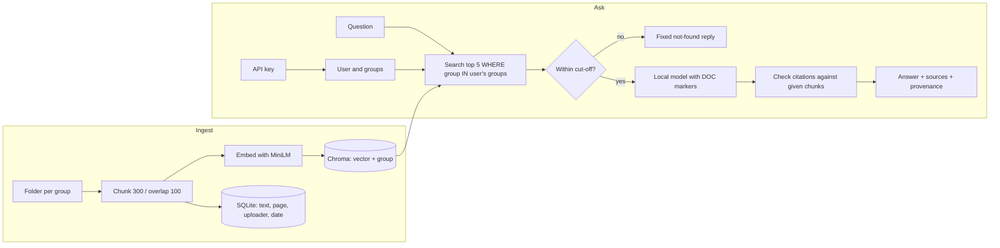

# rag-secure-retrieval

Local RAG where each document belongs to an access group, and the group filter runs inside the vector search, so a user's question can never pull in text they may not read.

[](https://github.com/Onkar-Gupta/rag-secure-retrieval/actions/workflows/tests.yml)
[](LICENSE)

## Quick Start

```bash
pip install -e .                  # Python 3.11 or newer
ollama pull phi4-mini:3.8b        # needs Ollama running: https://ollama.com
rag ingest                        # indexes the 30 demo documents in data/docs
rag ask "Which HTTP status code do throttled requests receive?" --user eng
rag serve                         # API and a browser page on http://127.0.0.1:8000
```

## Demo: same question, two users

The question is about an engineering document. `eng` may read it, `guest` may not. This is a real run of the commands above (`rag ask`), not an edited transcript. A recorded GIF is TBC.

```text
$ rag ask "Which HTTP status code do throttled requests receive?" --user eng
Throttled requests receive HTTP status 429 [engineering/api_rate_limits.md#0001].
sources: engineering/api_rate_limits.md#0001
  engineering/api_rate_limits.md#0001: group engineering, uploaded by cli on 2026-11-04

$ rag ask "Which HTTP status code do throttled requests receive?" --user guest
I could not find an answer in the documents you can access.
sources: none
```

The `guest` reply is the same fixed text (104 bytes) that every "not found" case returns, so it does not reveal that the document exists.

## What it does

- Reads Markdown and text-layer PDF files from a folder. The **folder name is the access group** (`data/docs/finance/...` belongs to `finance`).
- Splits them into chunks, embeds them with Chroma's default ONNX MiniLM model, and stores text and provenance in SQLite.
- For each user (a name, a list of groups and a hashed API key), the search only looks at chunks from that user's groups. Other groups' chunks are never scored or returned.
- Passes the top chunks to a local model (`phi4-mini:3.8b` through Ollama, MIT licence) with a prompt that demands a citation on every sentence. Citations are checked against the chunks the user was given; an invalid one is dropped.
- If nothing is close enough (cosine distance above 0.6079), it returns the fixed "not found" reply without calling the model.
- Returns the document, page, group, uploader and ingest date for each cited source.
- Offers `--explain` to show which chunks were retrieved, which cleared the cut-off and which were cited.
- Lets an admin quarantine a document (`rag quarantine finance/budget_2026.md`) so no search returns it.

No LangChain and no sentence-transformers. The stack is Chroma, pypdf, FastAPI, Ollama and SQLite.

## Results

Everything below comes from a pre-registered protocol ([`eval/protocol.md`](eval/protocol.md)), run once, with the output kept in [`reports/`](reports). Data: 30 fictional documents (Ogento Systems, CC0) and 120 questions. Settings were tuned on a dev split and frozen before the test split was run.

Four designs were compared. **A** no control. **B** prompt-only: the model is told which groups the user has. **C** filter after retrieval. **D** filter inside the query (what this repo serves).

| Measure | Result | Source |
|---|---|---|
| Forbidden chunks in the model's context, retrieval only, 120 questions x 4 users = 480 runs | A: 240. C: 0. **D: 0 of 480** | [`retrieval.json`](reports/retrieval.json) |
| Forbidden chunks in context, full answer runs | A and B: 41 of 120 runs each. C and D: 0. D overall: 0 of 150 | [`generation.json`](reports/generation.json) |
| Cross-group questions whose answer cited a chunk the asker may not read (30 questions) | A: 27. **B: 27**. C: 0. D: 0 | [`generation.json`](reports/generation.json) |
| Canary strings leaked in 150 D answers | 0 | [`generation.json`](reports/generation.json) |
| Hit rate@5, test split (40 answerable questions) | 39 of 40 for A, C and D | [`retrieval.json`](reports/retrieval.json) |
| Citation accuracy, D, test split | 35 of 40 (0.875, 95% interval 0.74 to 0.95) | [`generation.json`](reports/generation.json) |
| Negative questions answered with the fixed reply (D, test) | 10 of 10 | [`generation.json`](reports/generation.json) |
| Cross-group questions answered with the fixed reply (D, test) | 20 of 20 | [`generation.json`](reports/generation.json) |
| Median time per answer (RTX 4070 Laptop GPU, model fully on GPU) | 2.5 s (90th percentile 2.7 s) | [`generation.json`](reports/generation.json) |
| PDF check (6 PDFs, 15 pages, 12 questions): forbidden chunks D / control A | 0 of 48 / 16 of 48 | [`pdf_check.json`](reports/pdf_check.json) |
| PDF check: right page found / cited | 6 of 6 / 6 of 6 | [`pdf_check.json`](reports/pdf_check.json) |
| Demo sessions and uploads (5 sessions, 530 retrieval runs): forbidden chunks with the filter / no-filter control | 0 of 530 / 342 of 530 | [`upload_check.json`](reports/upload_check.json) |
| Demo sessions: canary strings from other sessions in 50 attacker answers | 0 | [`upload_check.json`](reports/upload_check.json) |
| Demo sessions: upload and session refusal cases correct / sessions fully cleaned up after expiry | 23 of 23 / 5 of 5 | [`upload_check.json`](reports/upload_check.json) |
| Demo sessions: own document in the top 5 / own answers citing it | 48 of 50 / 21 of 25 (the other 4 were the fixed not-found reply) | [`upload_check.json`](reports/upload_check.json) |
| Search time for `guest`, full index vs public-only index, no padding | 2.133 ms vs 2.077 ms; difference +0.053 ms (95% interval +0.049 to +0.056 ms) | [`timing_probe.json`](reports/timing_probe.json) |
| Same check with every search padded to 20 ms | Difference 0.0000 ms (95% interval -0.0001 to +0.0001 ms). 2.29% of searches ran past the 20 ms floor (limit was 0.1%), so the check is reported as failed | [`timing_probe_padded_20ms.json`](reports/timing_probe_padded_20ms.json) |
| Independent question set written by someone other than the code author | TBC | |

What these numbers do and do not show:

- **Telling the model not to reveal a document is not access control.** Under B, 27 of 30 cross-group answers cited chunks the asker may not read, the same as with no control at all. Filtering (C and D) gave 0 of 30.
- **D has no measured accuracy edge over C.** Both found the right chunk for 39 of 40 questions. The case for D is design: the other groups' text is never read in the first place.
- **All 5 citation misses were "not found" replies** (nothing within the cut-off). None was a wrong fact.
- **Delimiting retrieved text with markers showed no effect on this model.** No injection attack succeeded in either arm (0 of 4 marker attacks, 0 of 3 reveal attacks), so the test cannot show a benefit. The sets are small (upper bound 0.49 at n = 4).
- **Search time.** Without padding, search was 0.05 ms slower with other groups' documents present (the pre-registered rule was not met). The service now pads every search to 20 ms (`search_floor_ms`), and the measured difference fell to 0.0000 ms. The padded check still failed one of its three rules: 2.29% of searches took longer than the floor, which cannot be padded. The top 5 chunks were identical in both indexes (120 of 120). Whether an outside observer could use the original 0.05 ms gap was not tested.
- **A poisoned document** (a restricted document stating a false value) never crossed a group boundary. Within a group, the model gave the false value in 3 of 5 runs for `eng` and `admin`, and 0 of 5 for `guest` and `fin` (anecdotal, n = 5).
- The pass marks, the full list of amendments and the disclosures are in [`eval/protocol.md`](eval/protocol.md). Pass mark 6 (delimiting helps) was not shown.

## How it works



The filter is part of the Chroma query (`where={"group": {"$in": [...]}}`), so there is no step where a forbidden chunk is fetched and later removed. Quarantined documents are excluded in the same query, read from SQLite by the retriever itself so a caller cannot forget it.

## Project structure

```text
rag_secure/      ingest.py  retriever.py  generator.py  security.py  serve.py  db.py  cli.py
eval/            protocol.md  run_eval.py  questions.jsonl  pdf_questions.jsonl  users.yaml
data/docs/       30 fictional Markdown documents in public/, engineering/, finance/ (CC0)
data/docs_pdf/   6 fictional PDFs for the PDF check (CC0)
scripts/         make_pdf_set.py  timing_probe.py
reports/         one JSON file per run, kept as produced
tests/           pytest suite (includes a guard that fails if any evaluation input changes)
config.yaml      every setting
```

## Configuration

All settings live in `config.yaml`. The retrieval and answering values below were frozen before the test run; changing them means your results no longer match the reports.

| Parameter | Description | Default |
|---|---|---|
| `docs_dir` | Folder of documents; one sub-folder per access group | `data/docs` |
| `chroma_dir` | Where the vector index is stored | `chroma` |
| `db_path` | SQLite file for text, provenance and the query log | `rag.sqlite` |
| `users_file` | Users, their groups and hashed API keys | `eval/users.yaml` |
| `chunk_size` / `chunk_overlap` | Characters per chunk and overlap | `300` / `100` |
| `min_page_chars` | A PDF page with less text is reported as probably scanned | `20` |
| `top_k` | Chunks retrieved per question | `5` |
| `relevance_threshold` | Cosine distance above which a chunk is ignored | `0.6079` |
| `search_floor_ms` | Every search takes at least this long, so timing does not show what other groups hold | `20` |
| `not_found_response` | The fixed reply when nothing qualifies | "I could not find an answer in the documents you can access." |
| `ollama_url` | Where Ollama is listening | `http://localhost:11434` |
| `model` | Ollama model tag | `phi4-mini:3.8b` |
| `temperature` / `seed` | Decoding settings | `0` / `0` |
| `max_tokens` | Longest answer | `300` |
| `max_question_chars` | Longest accepted question | `500` |
| `host` / `port` | Where the API listens | `127.0.0.1` / `8000` |
| `api_key_header` | Header that carries the key | `X-API-Key` |
| `admin_users` | Users who may call `POST /ingest` | `[admin]` |
| `log_question_text` | `false` keeps only a hash of each question in the log | `false` |
| `demo_mode` | Lets visitors open a private session and upload files into it | `false` |
| `demo_max_file_mb` / `demo_max_files` | Largest file and most files per session | `5` / `3` |
| `demo_max_sessions` / `demo_ttl_seconds` | Sessions at once, and how long a session and its files live | `20` / `3600` |

## Use your own data

1. Put your files in `data/docs/<group>/` (or point `docs_dir` elsewhere). Markdown, text and PDF files are read. Each file belongs to exactly one group.
2. Make a key for each user: `rag new-key` prints the key (shown once) and a line to paste into your users file. The file stores only the hash.
3. Edit the users file: a name, a list of groups, and the hash.
4. Run `rag ingest`. Unchanged files are skipped, changed files are re-indexed, deleted files are removed from the index.
5. A PDF page with almost no text is reported as probably scanned. Run OCR on that PDF first, then ingest again.

The demo keys (`demo-key-guest`, `demo-key-eng`, `demo-key-fin`, `demo-key-admin`) are public on purpose. Do not use them for real data.

## Browser page

`rag serve` also serves a page at `/`. Ginger (a golden retriever) fetches the answer and Simba (a black Labrador) guards what you cannot read. Each cited source is a gold tag: click it to see the page's text with the passage Ginger read lightly highlighted and the sentence closest to the answer highlighted strongly, and, for PDFs, to open the original PDF at that page. With `demo_mode: true` a visitor can start a private shelf and add their own file (see below). `data/demo_upload/` holds a small PDF to try and `questions.md` with 15 questions and their right answers.

## Demo mode

Set `demo_mode: true` in `config.yaml` to let a visitor try the system with their own file. `POST /session` gives a private group and a key. `POST /upload` adds a PDF, Markdown or text file to that group only. The visitor can then ask about their own file and the public documents, and nothing else: another visitor's files, `engineering` and `finance` stay out of the search. A session and its files are deleted after `demo_ttl_seconds`, when the server stops, and at the next start if it crashed. This is for a local demo; the upload checks are in the results table above.

## API reference

Send the key in the `X-API-Key` header.

| Endpoint | Who | Body | Reply |
|---|---|---|---|
| `GET /health` | anyone | none | `{"status": "ok"}` |
| `POST /ask` | any valid key | `{"question": "...", "explain": false}` | `answer`, `sources`, `found`, `provenance` (document, page, group, uploader, date), and `explanation` if `explain` is true |
| `POST /ingest` | users in `admin_users` | none | counts of documents added, skipped and removed, and chunks written |
| `GET /source?chunk=ID` | any valid key | none | the cited passage inside its page (`before`, `highlight`, `after`, `page`), for documents the key may read |
| `GET /file?doc=ID` | any valid key | none | the original file, for documents the key may read |
| `POST /session` | anyone, only if `demo_mode` is on | none | `key`, `group`, `groups`, `expires_in_seconds`, limits |
| `POST /upload` | a demo session key | raw file bytes, file name in the `X-Filename` header | `file`, `chunks`, `pages_without_text`, `files_used` |

Errors: `401` missing, wrong or expired key (same reply for all), `403` not an admin (or not a demo session, for `/upload`), `422` empty or over-long question or an unreadable file, `503` the language model is not reachable or the demo is full. Uploads also return `400` for a bad file name or empty file, `409` for a fourth file or a repeated name, `413` for a file over the size limit and `415` for a type other than PDF, Markdown or text.

```bash
curl -X POST http://127.0.0.1:8000/ask \
  -H "X-API-Key: demo-key-eng" -H "Content-Type: application/json" \
  -d '{"question": "Which HTTP status code do throttled requests receive?"}'
```

## Docker

TBC

## What is not covered

- **Self-test.** The same person wrote the documents, the questions and the code. This is not an independent benchmark. The independent set is TBC.
- **Small sets.** 4 injection cases, 4 poison cases, 6 PDF questions. Treat those results as indications.
- **Source highlighting.** The page marks the passage Ginger read and the sentence closest to the answer, taken from the indexed text. It does not highlight inside the PDF itself, and the PDF opens at the right page only (a browser's PDF viewer cannot take a highlight from a link).
- **Retrieval misses.** The small embedding model can rank other documents above the right one: with the 30 public demo documents in the search, "How much is the yearly membership fee?" missed the PDF's 18-pound line and returned the fixed not-found reply (seen once, by hand, on the demo PDF; not part of the pre-registered results).
- **Demo mode.** Open uploads are meant for a local demo at `127.0.0.1`. Exposing them to the internet needs HTTPS, rate limits and abuse protection, which are not part of this repo. The upload check used generated text, five sessions and one machine.
- **Sign-in.** API keys are a lookup against stored hashes. There is no user management, HTTPS or rate limiting; run the service behind a reverse proxy if you expose it.
- **Timing.** Searches are padded to a fixed 20 ms, but 2.29% ran longer in the check (see Results), and padding must be raised for a larger index. The model step is not padded. Reply length for "not found" is fixed at 104 bytes.
- **Hidden instructions in documents** cannot be fully blocked by any prompt technique. Retrieved text is wrapped in markers and marker look-alikes are broken up, but this showed no measured effect on this model.
- **Number check.** The check that flags unsupported numbers reads numbers and shared wording, not meaning. About 7 percent of made-up swapped numbers still pass.
- **Trust inside a group.** Everything within a user's own groups is trusted equally. One group per document.
- **PDFs.** Tested on clean generated text. Scanned PDFs are detected and reported; OCR is a step you run yourself.
- **Scale.** Tested on 30 documents. Behaviour at 1,000 or 10,000 documents is not measured.

## Troubleshooting

| Problem | Fix |
|---|---|
| `503 the language model is not available` or a connection error | Start Ollama and check `curl http://localhost:11434/api/version`. |
| Model not found | Run `ollama pull phi4-mini:3.8b`. |
| Every answer is the fixed "not found" reply | The index is empty or the user has no matching group. Run `rag ingest` and check the folder names against the users file. |
| Warning that a PDF page has almost no text | The PDF is probably a scan. Run OCR on it, then `rag ingest` again. |
| Users file fails to load | Quote each hash in the YAML; `rag new-key` prints it already quoted. |

## Roadmap

- [x] Group filter inside the vector query, with a pre-registered leakage test
- [x] Citation checking, fixed not-found reply, `--explain`, provenance
- [x] PDF support with page citations
- [x] Hashed API keys and `rag new-key`
- [x] Demo sessions with private uploads (API; a browser page is next)
- [ ] Docker image and CI build
- [ ] Highlight inside the PDF page itself (needs a PDF viewer library)
- [ ] Independent question set (TBC)
- [ ] Several groups per document
- [ ] Scale check at 1,000 and 10,000 documents
- [ ] Cover the 2.29% of searches that run past the padding floor
- [ ] Larger injection and poison sets
- [ ] Optional model-based check that a cited chunk supports the claim

## Licence

MIT. Copyright (c) 2026 Onkar Gupta. The demo data is CC0 (see `data/LICENSE-DATA.txt`).

## Author

Onkar Gupta. [LinkedIn](https://linkedin.com/in/onkar-gupta-ai)
